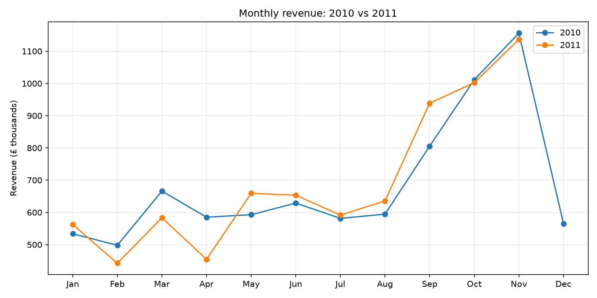

# Online Retail Sales Analysis (Dec 2009 - Nov 2011)

Analysis of two years of transactions from a UK-based online gift retailer, using **Python, DuckDB (SQL), pandas and matplotlib**.

## Question
How does revenue develop over the year, and what drives the peaks?

## Data
- **Source:** Online Retail II dataset (UCI Machine Learning Repository)
- **Period:** 1 Dec 2009 - 9 Dec 2011
- **After cleaning:** 776,577 rows. Cancelled invoices, returns (quantity <= 0), zero prices and rows without a customer ID were removed.
- December 2011 is left out of the monthly analysis because the data ends on 9 December.

## Findings
1. **Strong seasonality.** Revenue climbs from September and peaks in November in both years (£1.16M in Nov 2010, £1.14M in Nov 2011). September to November bring in about 36-37% of yearly revenue.
2. **No growth year on year.** Dec 2010 - Nov 2011 revenue was £8.23M vs £8.33M the year before (-1.3%).
3. **Peaks come from more customers, not bigger spending.** Active customers more than double from February to November 2011 (757 to 1,660), while revenue per customer stays between about £530 and £760.
4. **December drops sharply.** Revenue halves from November to December 2010, which suggests Christmas orders are placed in October and November.

## Project structure
- `notebooks/` - data cleaning and exploration notebooks
- `images/` - saved charts
- `data/` - not included (download the dataset from UCI)

## Tools
Python, DuckDB, SQL, pandas, matplotlib, Jupyter
